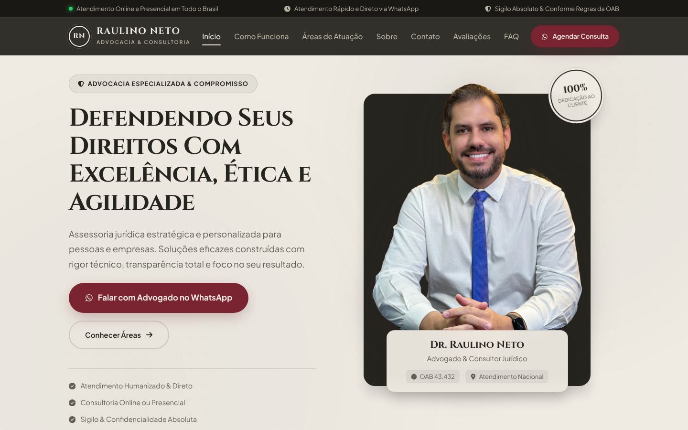
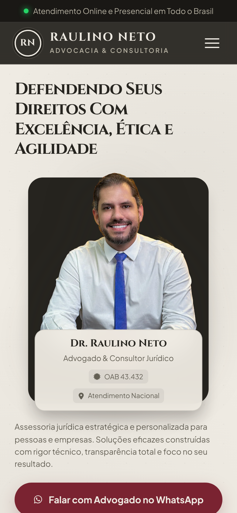
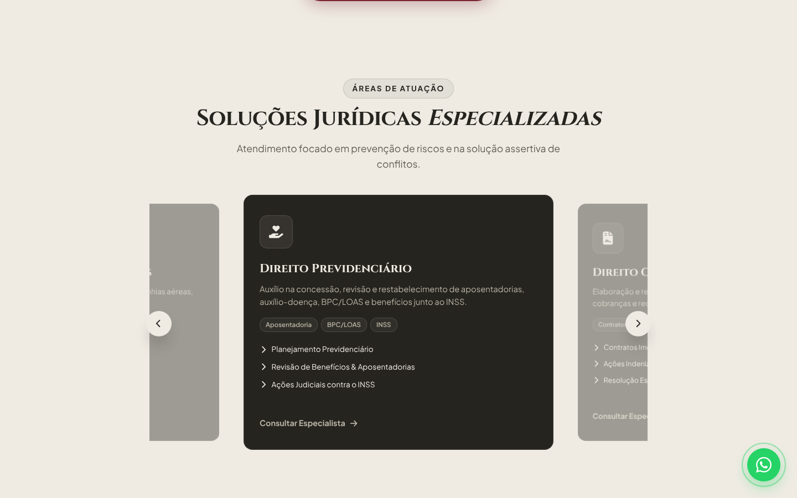
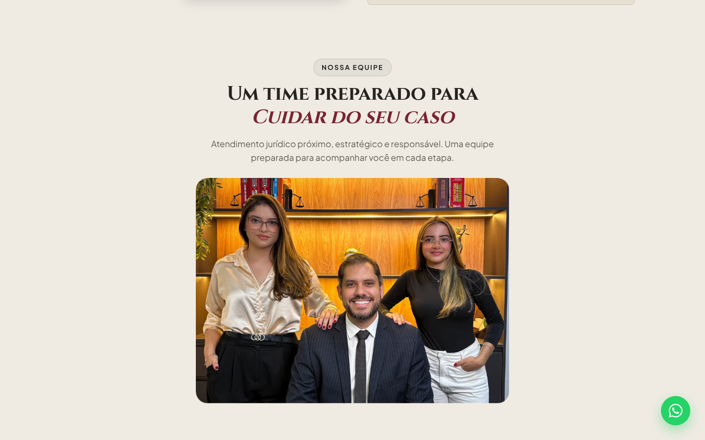

# Case: Raulino Neto Advocacia

Site institucional de advocacia criado do zero para gerar contato qualificado no WhatsApp.

🌐 **No ar:** [raulinonetoadvocacia.com.br](https://raulinonetoadvocacia.com.br)

> O código deste projeto é privado, a pedido do cliente. Aqui fica a vitrine: o que foi feito, por que e como ficou.

## O desafio

O escritório atende previdenciário, trabalhista, civil, consumidor e empresarial. Precisava de um site que:
- passasse confiança logo na primeira tela;
- levasse o visitante direto para o WhatsApp, já dizendo o assunto;
- respeitasse as regras de publicidade da OAB e a LGPD;
- servisse de destino para anúncios no Meta e no Google.

## O que foi entregue

| Recurso | Resultado para o cliente |
|---|---|
| **WhatsApp com mensagem pronta por área** (previdenciário, trabalhista, civil…) | O lead chega dizendo o que precisa e o atendimento começa mais rápido |
| **Formulário de contato** que envia para o WhatsApp | Captação sem custo de servidor |
| **Carrossel de áreas de atuação** feito à mão, sem biblioteca | Página leve e rápida no celular |
| **Seções de método, estrutura, equipe e FAQ** | Responde as objeções antes do primeiro contato |
| **Política de privacidade (LGPD)** e linguagem dentro das regras da OAB | Pronto para rodar anúncio sem risco |
| **Schema.org `Attorney`** e meta tags de compartilhamento | Melhor leitura no Google e preview bonito no WhatsApp |
| **Domínio próprio** (Registro.br) e hospedagem na **Vercel** | Endereço profissional e site no ar 24h |

  

## Tecnologias

HTML · CSS · JavaScript puro · Vercel · Registro.br

---

Feito por **Gustavo Nobre · Nobreworks** — landing pages + tráfego pago.
Quer um site assim? [Fale comigo no WhatsApp](https://wa.me/5588988941787).
